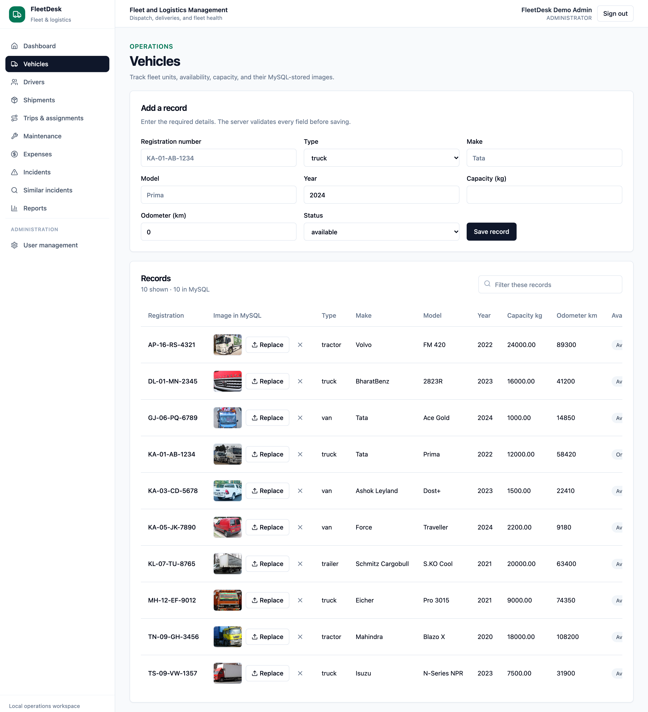
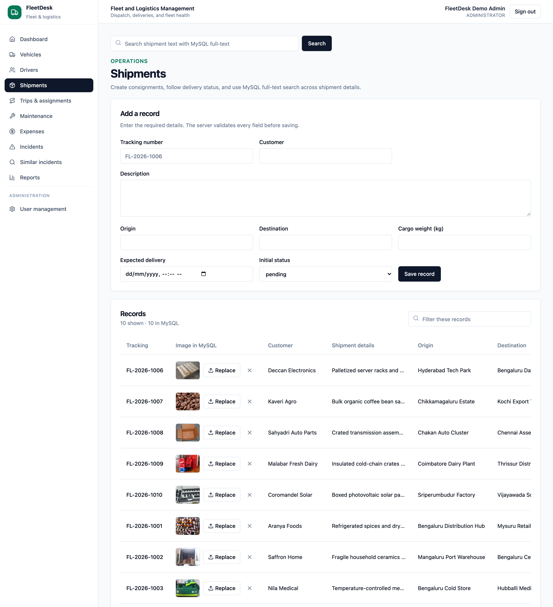
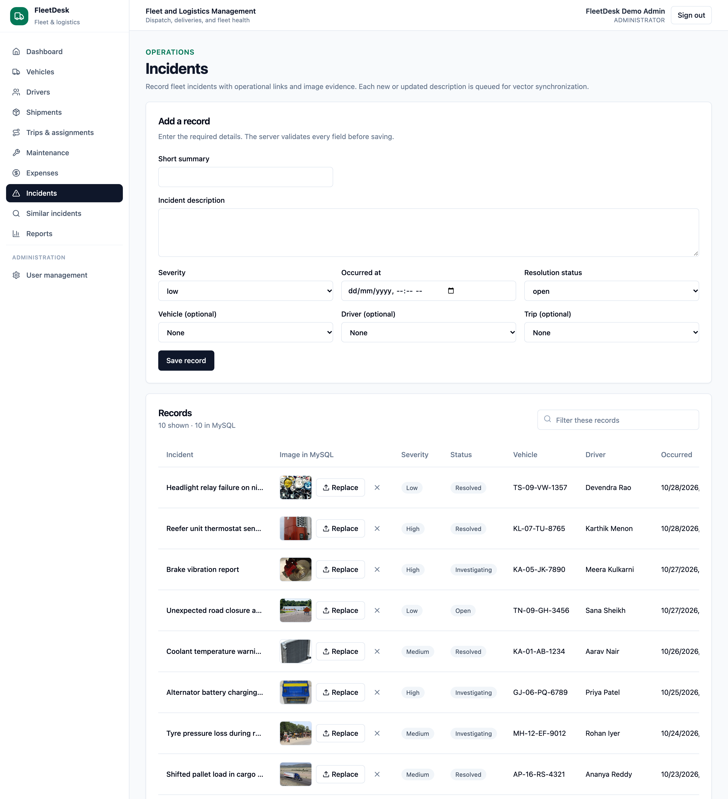

# FleetDesk — Fleet and Logistics Management

A local DBMS Level 3 project for managing vehicles, drivers, shipments, trips, maintenance, expenses, and incidents. MySQL is the source of truth for operational records. PostgreSQL with `pgvector` stores the 768-dimensional incident vector search index. An in-process deterministic Node.js semantic embedding engine generates 768-dimensional normalized embeddings directly in the backend — no external Ollama daemon or paid cloud AI service is required.

## Repository layout

- `app/` — Next.js App Router pages and API route handlers (`/api/*`)
- `frontend/` — React UI components (`frontend/components/`) and client utilities (`frontend/lib/`)
- `backend/` — Database pools, SQL/pgvector query modules (`backend/lib/`), MySQL & PostgreSQL DDL/programmability scripts (`backend/sql/`), and local setup/seed scripts (`backend/scripts/`)
- `docs/` — Architecture, ER diagram, data dictionary, runnable SQL examples, vector search guide, and testing results

## Features

- Dashboard totals, shipment status counts, recent incidents, and expense totals are queried from MySQL.
- Management pages provide validated create, update, delete, search, and status workflows for fleet records.
- Trip assignment calls a MySQL stored procedure (`sp_assign_trip`) that locks and validates the trip, vehicle, driver, and shipments before committing.
- Shipment status triggers write an audit history (`shipment_status_history`) and prevent delivered shipments from reverting.
- Vehicle, shipment, and incident images are saved as actual `MEDIUMBLOB` bytes in separate MySQL tables (`vehicle_images`, `shipment_images`, `incident_images`). The server accepts PNG, JPEG, WebP, and GIF files up to 5 MiB.
- Incident descriptions are embedded in-process into 768-dimensional L2-normalized vectors (`backend/lib/vector.ts`), synchronized to PostgreSQL (`incident_vectors`) through a retryable MySQL outbox (`incident_vector_jobs`), and ranked using `pgvector` cosine distance (`<=>`).
- Admin and Operations roles use scrypt password hashes and opaque server-side sessions. User management is Admin-only.
- Searchable shipments use MySQL full-text indexing (`MATCH ... AGAINST`). Reports demonstrate views, a stored function (`fn_vehicle_expense_total`), joins, correlated subqueries, recursive CTEs (`WITH RECURSIVE`), aggregates, and a window function (`RANK() OVER`).

## Stack and template

The interface reuses the Vercel Admin Dashboard template’s App Router layout, navigation, Tailwind setup, and shadcn-style components from [vercel/nextjs-postgres-nextauth-tailwindcss-template](https://github.com/vercel/nextjs-postgres-nextauth-tailwindcss-template). The template’s MIT license is retained in `LICENSE.md`. Its original PostgreSQL/Auth.js OAuth demo data path was removed; app authentication and operational access now use local MySQL sessions. PostgreSQL is reserved for `pgvector` incident search.

- Next.js App Router, React, TypeScript, Tailwind CSS
- MySQL Community Server for relational data, BLOB images, full-text search, and routines
- PostgreSQL + `pgvector` for 768-dimensional embeddings and HNSW nearest-neighbor cosine search
- Vitest for unit and local API integration tests

## Local setup (macOS + Homebrew)

The checked-in setup scripts target a local Homebrew MySQL and PostgreSQL installation. The app databases bind to loopback only and use their own project data directories and ports (`3307` and `5433`), so they do not require a cloud account or deployment.

1. Install Homebrew if it is not already installed, then install the local runtimes:

   ```sh
   brew install node mysql postgresql@18 pgvector
   export PATH="$(brew --prefix mysql)/bin:$(brew --prefix postgresql@18)/bin:$PATH"
   node --version
   npm --version
   ```

2. Open Terminal in the project directory and install JavaScript dependencies:

   ```sh
   npm install
   ```

3. Create the local environment, start the project-isolated databases, create both schemas, and seed the database + `pgvector` index:

   ```sh
   ./backend/scripts/setup-local.sh
   npm run db:seed
   npm run db:sync-vectors
   ```

   `setup-local.sh` creates a random `.env.local` with mode `600` if one does not exist. It initializes MySQL on `127.0.0.1:3307`, PostgreSQL on `127.0.0.1:5433`, grants the local `fleet_app` user access to the project databases, and loads `backend/sql/mysql/001_schema.sql`, `backend/sql/mysql/002_programmability.sql`, and `backend/sql/postgres/001_vector_schema.sql`. Seed data inserts 10 vehicles, 10 drivers, 10 shipments, 10 incidents, and 30 real `MEDIUMBLOB` images, and is idempotent.

4. Create the first Admin. Replace the example name, email, and password with your own values (at least 12 characters):

   ```sh
   FLEET_ADMIN_PASSWORD='replace-with-your-own-12-character-password' \
     npm run admin:create -- --name "Fleet Administrator" --email admin@example.local
   ```

   The password is salted and hashed with scrypt before it is inserted. This one-time command refuses to run after any account exists; later accounts are managed on the Admin-only **User management** page.

5. Start the app:

   ```sh
   npm run dev
   ```

   Open [http://localhost:3000](http://localhost:3000) and sign in with the Admin account. MySQL and PostgreSQL run as local processes after the setup script starts them.

### Stop and restart

- Stop Next.js with `Ctrl+C` in its terminal.
- Stop the project-local databases with `./backend/scripts/stop-local-databases.sh`.
- On a later run, start databases with `./backend/scripts/start-local-databases.sh`, then run `npm run dev`. Do not run `setup-local.sh` again unless you intentionally want to reload the schema.
- Project data lives under `.local-data/`; it is ignored by Git. `.env.local` is ignored as well.

## Application screenshots







## Commands

```sh
npm run typecheck        # TypeScript check
npm run lint             # ESLint
npm test                 # unit tests (no DB required)
npm run test:integration # real local API + MySQL + PostgreSQL; requires app at localhost:3000
npm run build            # optimized production bundle (webpack)
npm start                # serve the built app at localhost:3000
npm run db:seed          # insert/update fictional demonstration records and 30 BLOB images
npm run db:sync-vectors  # synchronize pending/failed incident embedding jobs to PostgreSQL pgvector
```

For integration tests, export credentials for an existing Admin first:

```sh
export TEST_ADMIN_EMAIL=admin@example.local
export TEST_ADMIN_PASSWORD='your-local-admin-password'
npm run test:integration
unset TEST_ADMIN_EMAIL TEST_ADMIN_PASSWORD
```

The integration suite creates uniquely named test records and removes them when it finishes. See [`docs/testing.md`](docs/testing.md) for the exact test coverage and observed results.

## Documentation map

- [`docs/architecture.md`](docs/architecture.md) — problem, scope, architecture, ER model, mappings, roles, transaction boundaries, conclusion, and future enhancements.
- [`docs/data-dictionary.md`](docs/data-dictionary.md) — relational schema, keys, constraints, and normalization.
- [`docs/sql-examples.sql`](docs/sql-examples.sql) — runnable DDL (`CREATE`, `ALTER`, `DROP`)/DML examples, joins, aggregates, subqueries, recursive CTEs, set operations, windows, full-text search, and plans.
- [`docs/vector-search.md`](docs/vector-search.md) — 768-dim embedding generator, `pgvector` cosine search, outbox retries, and limitations.
- [`docs/testing.md`](docs/testing.md) — test workflow, cases, actual results, and tested runtime versions.
- [`docs/troubleshooting.md`](docs/troubleshooting.md) — local service and login fixes.
- [`docs/demo-script.md`](docs/demo-script.md) — short project evaluation walkthrough.

## Conclusion and future enhancements

This project demonstrates a normalized 3NF/BCNF relational design in MySQL (`backend/sql/mysql/001_schema.sql`), referential integrity, procedural SQL (`sp_assign_trip`, `fn_vehicle_expense_total`, and three shipment audit triggers in `backend/sql/mysql/002_programmability.sql`), row locking, transaction rollback, binary `MEDIUMBLOB` image storage, full-text search, recursive CTEs (`WITH RECURSIVE`), window functions, application-level RBAC, a durable cross-database outbox, and genuine `pgvector` HNSW cosine similarity search in PostgreSQL (`backend/sql/postgres/001_vector_schema.sql`) in one locally runnable application.

Future enhancements include:
- Real-time GPS telemetry ingestion partitioned by timestamp for live route deviation alerts.
- Automated preventive maintenance scheduling triggered when `odometer_km` crosses service intervals.
- Multi-depot dispatch optimization and customer-facing shipment tracking portals.
