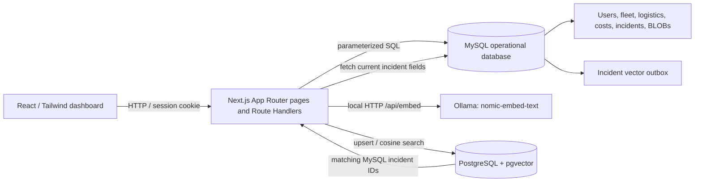
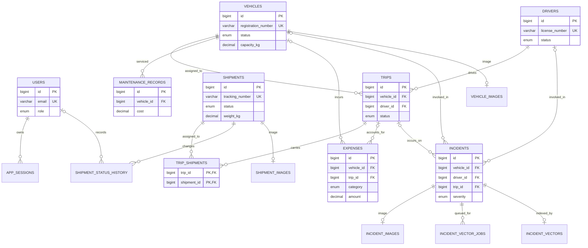

# Architecture and design

## Problem statement

Fleet operations commonly spread vehicle availability, driver eligibility, delivery progress, maintenance, costs, and incident notes across separate records. FleetDesk brings those records into one local application and applies database constraints to key dispatch and delivery rules. It also lets an operator search incident descriptions by meaning rather than by exact word matches.

## Objectives and scope

The project is a locally runnable DBMS demonstration with two deliberately separate persistence roles:

1. **MySQL** owns all operational entities, authentication accounts/sessions, image bytes, shipment history, and the durable vector-sync queue.
2. **PostgreSQL + pgvector** owns an incident-only search index containing the incident ID, display metadata, source text, and a 768-dimensional embedding.

The local Next.js app provides login, dashboard, vehicles, drivers, shipments, trips, maintenance, expenses, incidents, similar incident search, reports, and Admin-only user management. It is not a hosted dispatch platform, a GPS tracker, a billing product, or a cloud AI service.

## Functional requirements implemented

| Area | What the application does |
| --- | --- |
| Authentication | Authenticates MySQL users with scrypt password hashes and opaque HTTP-only sessions stored as token hashes. |
| Authorization | Enforces Admin and Operations roles in server-rendered pages and Route Handlers. Only Admin can access user management. |
| Fleet and drivers | Validates unique registration/license numbers, capacities, license dates, and availability statuses. |
| Shipments | Searches with MySQL FULLTEXT, checks legal status changes, and records each status transition. |
| Trips | Assigns shipments and performs a locking, transactional vehicle/driver/load eligibility check in `sp_assign_trip`. |
| Maintenance and expenses | Saves normalized service and expense records; dashboard and reports aggregate real rows. |
| Incidents | Stores incident detail in MySQL, syncs a local embedding to pgvector, ranks natural-language search, and rejoins result IDs to live MySQL records. |
| Images | Validates the file signature and size, stores binary data in owner-specific MySQL BLOB tables, and supports retrieval, replacement, and deletion. |

## Architecture

All database credentials and connection pools are used in server-only modules. SQL values use placeholders. The only dynamic SQL identifiers in the image route are selected from a fixed map of three known image tables; record values remain parameters.

### Request examples

- `GET /api/dashboard` reads MySQL metrics, shipment counts, spending, and incidents.
- `POST /api/trips/:id/assign` calls `CALL sp_assign_trip(?,?,?)` after session authorization.
- `POST /api/incidents/search` embeds the query on the local Ollama service, searches pgvector by cosine distance, then loads current status and incident IDs from MySQL.
- `GET /api/images/vehicles/:id` reads `image_data` from MySQL and streams the original bytes with the detected MIME type and `nosniff` header.

## Entity relationship model

`INCIDENT_VECTORS` is physically in PostgreSQL, so the line to `INCIDENTS` represents an application-managed ID relationship rather than a database foreign key. The vector ID is looked up in MySQL before a result is shown. Each MySQL image table has one row per owner and a real owner foreign key.

## ER-to-relational mapping

- Each strong entity maps to one MySQL table with an auto-increment primary key.
- The trip-to-shipment many-to-many relationship maps to `trip_shipments(trip_id, shipment_id)` with a composite primary key and two foreign keys.
- One-to-many relationships use foreign keys on the “many” side: trip driver/vehicle, maintenance vehicle, expenses’ optional vehicle/trip, incidents’ optional vehicle/driver/trip, and shipment history.
- Optional one-to-one images use three separate tables. The owner FK is also the image table’s primary key, preventing an image from referencing a nonexistent or wrong-kind owner.
- The status-change relationship is an audit entity (`shipment_status_history`) so a shipment can have any number of immutable transition rows.
- `incident_vector_jobs` is an outbox event relation. It stores a content snapshot so that an update/delete can still be synchronized after the source row changes or is removed.

## Transaction and concurrency boundaries

Trip creation, selected shipment linking, and maintenance creation use MySQL transactions where multiple related writes must succeed together. `sp_assign_trip` starts its own transaction, uses `SELECT ... FOR UPDATE` on trip/vehicle/driver rows, checks the license date and summed shipment weight, then updates the trip, vehicle, driver, and shipment statuses before commit. Its exception handler rolls back and re-signals the SQL error. A failed assignment leaves the trip unassigned; the integration suite reads that state directly from MySQL.

MySQL and PostgreSQL do **not** share a transaction. An incident row and its outbox job commit together in MySQL. A separate synchronization step creates or deletes the pgvector row and then marks the MySQL job done. If local embedding generation or PostgreSQL fails, the MySQL job records a failure and can be retried from the Incidents page or with `npm run db:sync-vectors`.

## Security notes

- Passwords use salted scrypt hashes; no plaintext password is persisted.
- Session cookies are HTTP-only, SameSite=Lax, and Secure in production. Only an HMAC hash of the random token is stored in MySQL. Sessions expire after 12 hours.
- Authorization is checked again in each route handler. Hiding Admin navigation is not the authorization boundary.
- `.env.local`, model files, data directories, and Next build output are ignored by Git.
- Database servers bind to `127.0.0.1`; this setup does not expose a public endpoint.
- Image upload trusts bytes inspected by the server, not the browser MIME type or filename.

## Technology justification

MySQL is used because the required operational model is highly relational and the project demonstrates native MySQL constraints, FULLTEXT, triggers, a function, a stored procedure, and transaction/locking behavior. PostgreSQL is retained only for the pgvector extension and vector index. Ollama allows real sentence embeddings to run locally without a paid service. The Vercel template supplies the navigation and component styling while the original cloud-oriented database/auth wiring is replaced with local modules.
